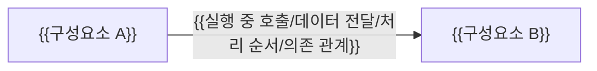

# {{관점 이름}} 아키텍처

{{이 문서가 답하는 구조 질문과 핵심 결론을 한 문단으로 쓴다. 코드 위치와 진입점은 코드 지도에 두고 링크한다.}}

| 항목 | 값 |
| --- | --- |
| 구조 시점 | Target |
| 문서 상태 | Draft |
| 구현 대조 | 미대조 |
| 범위 | {{배포 방식/보안/데이터 전달/전환 계획 등}} |
| 코드 지도 | {{코드 지도 링크}} |
| 관련 PRD | {{ID와 링크}} |
| 관련 스펙·계약 | {{링크}} |
| 관련 ADR | {{링크}} |
| 최종 확인일 | YYYY-MM-DD |

## 1. 구조 관점과 범위

{{포함하는 구조, 생략한 세부 내용과 그림 화살표의 의미를 쓴다.}}

## 2. 구성요소와 책임

| 구성요소 | 주된 책임 | 맡지 않는 책임 | 의존 대상 |
| --- | --- | --- | --- |
| {{이름}} | {{책임}} | {{맡지 않는 책임}} | {{대상}} |

## 3. 핵심 흐름

1. {{입력과 시작점}}
2. {{경계를 지나는 흐름}}
3. {{상태와 결과}}

## 4. 경계와 제약

- 신뢰 경계(Trust boundary, 신원·권한을 다시 확인하는 지점): {{접근 주체의 신원과 권한을 확인하고 제한을 적용하는 지점}}
- 의존 방향 규칙: {{어느 구성요소가 어느 구성요소에 기댈 수 있는지}}
- 실행·배포 자원 대응: {{역할에 따라 나눈 구성요소가 어떤 실행·배포 자원에 해당하는지}}

## 5. 현재 구조와의 차이 또는 전환 조건

{{목표 구조(Target)나 전환 중 구조(Transitional)라면 현재 구조(Current)와의 차이, 전환 방법과 기존 구조의 제거 조건을 쓴다.}}

## 6. 미결정 사항과 위험

| 항목 | 영향 | 확정 근거·후속 ADR |
| --- | --- | --- |
| {{항목}} | {{영향}} | {{링크}} |
