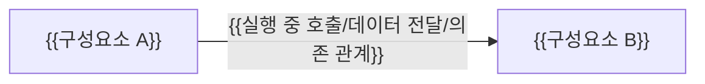

# {{프로젝트명}} 코드 지도

{{시스템이 무엇을 하는지, 코드가 어떤 큰 구성요소로 나뉘는지, 대표 요청이 어디서 시작해 어디서 끝나는지를 2~3문장으로 쓴다.}}

| 항목 | 값 |
| --- | --- |
| 구조 시점 | {{코드가 있으면 Current, 없으면 Target}} |
| 문서 상태 | Draft |
| 구현 대조 | 미대조 |
| 관련 PRD | {{PRD 문서 링크}} |
| 관련 ADR | {{링크 또는 없음}} |

## 1. 전체 구조

{{그림에 포함한 범위, 생략한 세부 내용과 화살표의 의미를 쓴다.}}

## 2. 코드 위치와 구성요소

| 코드 위치 | 구성요소 | 주된 책임 | 맡지 않는 책임 | 의존 대상 | 모듈 설계 |
| --- | --- | --- | --- | --- | --- |
| `{{디렉터리 경로}}` | {{이름}} | {{책임}} | {{다른 구성요소가 맡는 책임}} | {{대상}} | {{링크 또는 없음}} |

## 3. 진입점

요청이나 실행이 시작되는 코드 위치를 모두 적는다.

| 진입점 종류 | 코드 위치(파일·심볼) | 시작 조건 | 다음으로 호출하는 곳 |
| --- | --- | --- | --- |
| {{HTTP 요청/CLI 명령/예약 작업/화면 이벤트/메시지 수신}} | `{{파일 경로}}` `{{심볼}}` | {{언제 실행되는가}} | `{{파일 경로}}` `{{심볼}}` |

## 4. 핵심 흐름

대표 시나리오 하나를 진입점부터 결과까지 따라간다. 관련 스펙 시나리오: {{스펙 문서 경로와 시나리오 ID}}

| 순서 | 코드 위치(파일·심볼) | 하는 일 | 넘기는 값·바뀌는 상태 |
| --- | --- | --- | --- |
| 1 | `{{파일 경로}}` `{{심볼}}` | {{입력을 받아 무엇을 하는가}} | {{다음 단계로 넘기는 값}} |
| 2 | `{{파일 경로}}` `{{심볼}}` | {{처리}} | {{저장·외부 요청·화면 갱신 등 함수 밖의 변화}} |

## 5. 시작과 연결

- 시작 순서: {{프로그램이 시작될 때 무엇이 어떤 순서로 만들어지고 설정되는지}}
- 설정 위치: `{{설정 파일·환경 변수를 읽는 코드 위치}}`
- 객체 연결 위치: {{의존성 주입(DI) 등록처럼 객체를 만들어 서로 연결하는 코드 위치. 없으면 없음}}

## 6. 처음 읽을 코드

1. `{{파일 경로}}` — {{이 파일을 먼저 읽어야 하는 이유}}
2. `{{파일 경로}}` — {{이유}}

## 7. 확인하지 못한 부분

| 항목 | 확인하지 못한 이유 | 확인 방법 |
| --- | --- | --- |
| {{동적으로 연결되어 코드만으로 확인하지 못한 경로 등}} | {{이유}} | {{실행·로그·담당자 확인 등}} |
