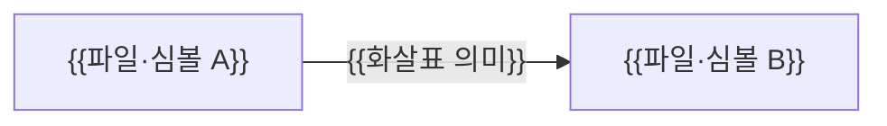

# {{모듈 이름}} 모듈 설계

{{이 모듈이 맡는 책임과 핵심 설계 결론을 한 문단으로 쓴다.}}

| 항목 | 값 |
| --- | --- |
| 구조 시점 | Target |
| 문서 상태 | Draft |
| 구현 대조 | 미대조 |
| 코드 위치 | `{{모듈 디렉터리 경로}}` |
| 코드 지도 | {{코드 지도 링크}} |
| 관련 스펙 | {{스펙 문서 경로와 시나리오 ID}} |
| 관련 계약 | {{링크 또는 없음}} |
| 관련 ADR | {{링크 또는 없음}} |

## 1. 책임과 경계

- 맡는 책임: {{이 모듈이 하는 일}}
- 맡지 않는 책임: {{다른 모듈이나 문서가 맡는 일}}
- 다른 모듈에 공개하는 기능: `{{다른 모듈이 호출하는 클래스·함수·이벤트}}`

## 2. 내부 구조

{{화살표의 의미(실행 중 호출, 데이터 전달, 컴파일 시 의존, 실행 중 주입)를 쓴다.}}

| 요소(파일·심볼) | 역할 | 만들어지는 시점과 소유자 | 의존 대상 |
| --- | --- | --- | --- |
| `{{파일 경로}}` `{{심볼}}` | {{역할}} | {{언제 누가 만들고 없애는가}} | {{대상}} |

## 3. 데이터 모델

모듈 밖과 주고받는 형식은 계약에 두고 여기에서는 링크한다.

| 이름 | 필드·형태 | 저장 위치 | 제약과 항상 지켜야 할 조건 |
| --- | --- | --- | --- |
| `{{타입·테이블 이름}}` | {{주요 필드와 자료형}} | {{메모리/DB 테이블/파일}} | {{예: 금액은 0 이상}} |

## 4. 처리 순서

대표 시나리오 {{SCN-001}}을 따라 모듈 안의 처리를 호출 순서대로 쓴다.

| 순서 | 코드 위치(파일·심볼) | 조건·계산 | 바뀌는 상태 | 결과를 쓰는 곳 |
| --- | --- | --- | --- | --- |
| 1 | `{{파일 경로}}` `{{심볼}}` | {{분기 조건이나 계산}} | {{값·상태 변화}} | {{다음 단계 또는 호출한 쪽}} |

## 5. 상태와 초기화

- 초기화·로딩 시점: {{모듈이 언제 메모리에 올라오고 준비되는지}}
- 상태 소유자와 제거 시점: {{상태를 누가 들고 있으며 언제 없어지는지}}
- 동시 실행과 순서: {{동시에 호출되거나 순서가 바뀔 때의 가정과 처리}}

## 6. 오류 처리

| 실패 지점 | 처리 방법 | 남는 상태 | 관련 스펙 시나리오 |
| --- | --- | --- | --- |
| `{{파일 경로}}` `{{심볼}}` | {{재시도/거절/되돌림}} | {{상태}} | {{시나리오 ID}} |

## 7. 설계 선택

모듈 안에서 내린 선택과 이유를 적는다. [ADR 작성 조건](../decisions/AGENTS.md)을 모두 만족하는 선택만 별도 ADR로 연결한다.

| 선택 | 이유 | 검토한 다른 방법 | 근거 |
| --- | --- | --- | --- |
| {{선택}} | {{이유}} | {{대안과 제외 이유}} | {{스펙·ADR·측정 링크}} |

## 8. 현재 코드와의 차이

`Target`이면 계획한 변경을 적는다. `Transitional`이면 채택된 전환 범위와 계획을 적는다. 근거 없는 차이는 [충돌 규칙](../AGENTS.md#기준-문서-적용과-충돌-처리)에 따라 처리한다. 설계와 구현이 일치하면 이 절을 제거하고 구조 시점을 `Current`로 바꾼다.

| 항목 | 현재 코드(파일·심볼) | 목표 설계 | 전환 계획 |
| --- | --- | --- | --- |
| {{항목}} | `{{파일 경로}}` `{{심볼}}` | {{이 문서의 절}} | {{전환 작업 또는 없음}} |

## 9. 미결정 사항

| 항목 | 영향 | 확정 위치 |
| --- | --- | --- |
| {{항목}} | {{영향}} | {{ADR/스펙/담당자}} |
