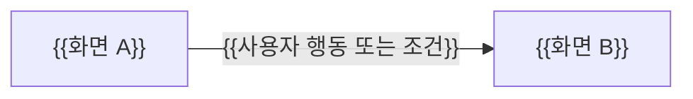

# {{기능 이름}} 화면 스펙

{{누가 어떤 목적으로 어떤 화면들을 거쳐 무엇을 완료하는지 한 문단으로 설명한다.}}

| 항목 | 값 |
| --- | --- |
| 상태 | Draft |
| 관련 요구사항 | {{PRD 문서 링크와 요구사항 ID}} |
| 관련 계약 | {{화면이 호출하는 API 계약 링크 또는 없음}} |
| 관련 아키텍처 문서 | {{코드 지도·프런트엔드 모듈 설계 링크}} |
| 관련 ADR | {{링크 또는 없음}} |
| 디자인 원본 | {{Figma 등 링크와 버전 또는 확인일. 없으면 없음}} |
| 디자인 기준과 코드 적용 규칙 | {{프로젝트 DESIGN.md·프런트엔드 컨벤션 링크}} |
| 관련 컴포넌트 예시 | {{실제 컴포넌트 미리보기 URL·예시 ID 또는 기존 카탈로그 링크. 없으면 없음}} |

선택 기준·시나리오 소유·와이어프레임 판정은 [스펙 작성 규칙](../specs/AGENTS.md)을 따른다. 색·간격·글꼴 값은 채택된 디자인 기준을 연결한다.

## 1. 범위와 사용자

- 사용자: {{화면을 쓰는 역할과 권한}}
- 포함: {{이 문서가 정의하는 화면과 동작}}
- 제외: {{다른 스펙이나 계약으로 분리한 내용}}

## 2. 화면 흐름

{{화살표는 사용자 행동에 따른 화면 이동을 뜻한다.}}



| 화면 ID | 화면 이름 | 들어오는 경로 | 나가는 경로 |
| --- | --- | --- | --- |
| SCR-001 | {{이름}} | {{이전 화면·링크·URL}} | {{다음 화면과 조건}} |

## 3. 화면별 구성

화면마다 아래 구성을 반복한다.

### SCR-001 {{화면 이름}}

```text
{{ASCII 와이어프레임. 예:
+------------------------------+
| [제목]                        |
| 이메일 [__________]           |
| [로그인]                      |
+------------------------------+}}
```

| 구성요소 | 표시 내용·입력 규칙 | 사용자 행동 | 결과 | 관련 시나리오 |
| --- | --- | --- | --- | --- |
| {{이름}} | {{보여 주는 값, 입력 형식·필수 여부}} | {{클릭·입력 등}} | {{화면 변화·이동·API 요청}} | {{SCN-001}} |

## 4. 화면 상태

| 화면 ID | 상태 | 진입 조건 | 보이는 내용 | 가능한 행동 |
| --- | --- | --- | --- | --- |
| SCR-001 | {{로딩/빈 화면/오류/권한 없음/정상}} | {{조건}} | {{표시 내용}} | {{재시도·이동 등}} |

## 5. 입력 검증과 오류

| 대상 | 조건 | 사용자에게 보이는 결과 | 입력값 유지 여부 |
| --- | --- | --- | --- |
| {{구성요소}} | {{잘못된 입력·서버 오류 등}} | {{오류 문구와 위치}} | {{유지/초기화}} |

## 6. 화면 크기와 접근성

- 화면 크기별 차이: {{모바일·데스크톱에서 달라지는 배치나 동작. 없으면 없음}}
- 접근성: {{키보드 이동 순서, 화면 낭독기용 이름 등 필요한 규칙. 없으면 없음}}

## 7. 수용 시험

화면 상태·행동·입력 검증별로 한 행을 쓴다. 결과와 증거는 [검증 기록](../AGENTS.md#검증-기록)을 따른다.

| 시나리오 ID | 요구사항 ID | 화면 ID | 조건과 사용자 행동 | 기대 결과 | 시험 위치 | 결과 | 실행 기록 |
| --- | --- | --- | --- | --- | --- | --- | --- |
| SCN-001 | FR-001 | SCR-001 | {{정상 조건과 행동}} | {{보이는 결과}} | {{시험 파일·이름}} | 미실행 | {{기록 링크 또는 미실행 이유}} |
| SCN-002 | FR-001 | SCR-001 | {{잘못된 입력}} | {{오류 표시와 남는 입력값}} | {{시험 파일·이름}} | 미실행 | {{기록 링크 또는 미실행 이유}} |

## 8. 미결정 사항

| ID | 항목 | 제약 | 확정 위치 |
| --- | --- | --- | --- |
| SPEC-TBD-001 | {{항목}} | {{제약}} | {{ADR/계약/디자인 원본/담당자}} |
